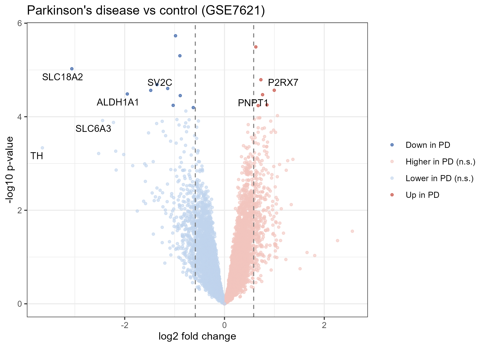
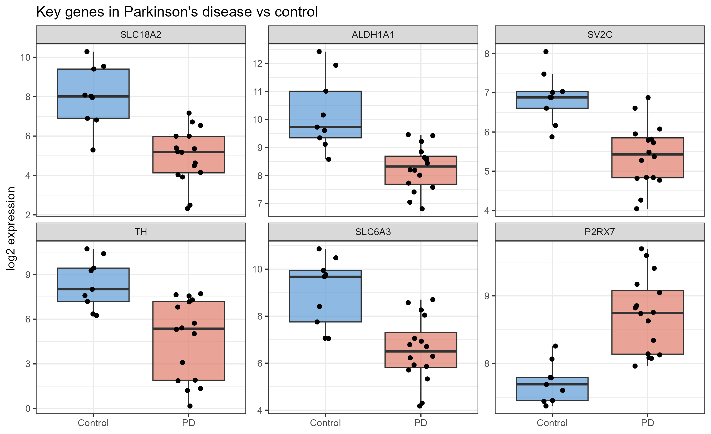
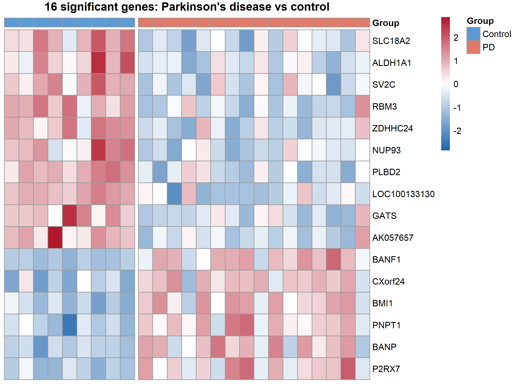

# Gene Expression Changes in the Parkinson's Disease Substantia Nigra (GSE7621)

**Question:** Which genes are more or less active in the substantia nigra of people with Parkinson's disease compared with healthy controls?

In Parkinson's disease, the dopamine-producing neurons of the substantia nigra gradually die. This project analyses public microarray data from post-mortem human brain tissue in R, using [limma](https://bioconductor.org/packages/release/bioc/html/limma.html), to find genes whose expression changes in the disease and to check whether the results reflect this known biology.

## Dataset

- **Source:** NCBI GEO, accession [GSE7621](https://www.ncbi.nlm.nih.gov/geo/query/acc.cgi?acc=GSE7621)
- **Samples:** post-mortem substantia nigra from 16 Parkinson's disease patients and 9 controls
- **Platform:** Affymetrix Human Genome U133 Plus 2.0 microarray (GPL570)

## Methods

1. **Data retrieval:** downloaded the expression data and sample information from GEO with `GEOquery`
2. **Pre-processing:** removed probes with missing values, log2-transformed the data and applied quantile normalisation so that samples are comparable
3. **Probe-to-gene mapping:** replaced microarray probe IDs with gene symbols and averaged probes measuring the same gene
4. **Filtering:** removed genes with below-median average expression to reduce noise and the multiple-testing burden
5. **Differential expression:** compared Parkinson's disease with controls using limma (linear models with empirical Bayes moderation), with Benjamini-Hochberg correction for multiple testing
6. **Thresholds:** adjusted p < 0.05 and at least a 1.5-fold change

## Results



**16 genes changed significantly:** 10 were lower and 6 were higher in Parkinson's disease.

**The strongest decreases were in dopamine-neuron genes.** Without any prior information about the disease, the analysis identified the loss of dopamine neurons, the hallmark of Parkinson's disease:

| Gene | Function | Change in PD |
|---|---|---|
| *SLC18A2* (VMAT2) | packages dopamine into vesicles for release | ~8-fold lower |
| *ALDH1A1* | marks the dopamine neurons most vulnerable in Parkinson's disease | ~4-fold lower |
| *SV2C* | synaptic vesicle protein enriched in dopamine neurons | ~2.8-fold lower |

*TH* (the enzyme that makes dopamine) and *SLC6A3* (the dopamine transporter) showed the largest fold changes of all (~12.5-fold and ~5.4-fold lower) but narrowly missed the significance threshold (adjusted p = 0.07 and 0.05), reflecting the small sample size.

**Smaller increases point to possible disease processes.** *P2RX7*, a receptor on microglia involved in neuroinflammation, was about 2-fold higher, and *PNPT1*, which functions in mitochondria, was also increased. These are modest changes and should be treated as signals for further study rather than firm conclusions.

**Expression of key genes in each person.** Each dot represents one individual. Dopamine-neuron genes are consistently lower in PD, while *P2RX7* is clearly higher. *TH* shows a very wide spread among PD patients, from almost no expression to near-control levels, likely reflecting different disease stages at death. This variability explains why *TH* narrowly missed significance despite having the largest average decrease.



**A consistent 16-gene signature.** Each row is a significant gene and each column is one person (z-scored per gene). The 10 down-regulated genes are mostly higher in controls and lower in PD, while the 6 up-regulated genes show the opposite pattern. One PD sample shows a control-like profile, highlighting variability between patients.



## Limitations

- **Small sample size** (25 samples) limits statistical power, so some real changes, such as *TH*, did not reach significance.
- **Cell loss affects bulk tissue data.** Lower dopamine-neuron gene levels mainly reflect fewer surviving neurons rather than changes within each cell.
- **Filtering trade-off.** Removing low-expression genes increased power but also removed some genes specific to rare cell types, such as *DDC*.
- **Post-mortem tissue** varies between donors (e.g. time after death, disease duration), adding variability.

A natural next step would be to test whether these changes replicate in an independent dataset, such as GSE49036.

## Files

| File | Description |
|---|---|
| `01_download_and_inspect.R` | Downloads the dataset from GEO and shows how samples are labelled |
| `PD_simple_analysis.R` | Pre-processing, differential expression analysis, volcano plot, boxplots and heatmap |
| `results_PD_vs_control.csv` | Full results table for all genes |
| `volcano_PD.png` | Volcano plot |
| `boxplots_key_genes.png` | Boxplots of key genes, one dot per person |
| `heatmap_significant_genes.png` | Heatmap of the 16 significant genes |

## How to run

```r
if (!require("BiocManager", quietly = TRUE)) install.packages("BiocManager")
BiocManager::install(c("GEOquery", "limma"))
install.packages(c("tidyverse", "ggrepel", "pheatmap"))

source("01_download_and_inspect.R")   # downloads the data
source("PD_simple_analysis.R")        # runs the analysis and makes all plots
```

## Skills demonstrated

Microarray data analysis · limma · normalisation and probe annotation · multiple-testing correction · biological interpretation of results · data visualisation with ggplot2 and pheatmap

## Related projects

- [Differential expression analysis with DESeq2 (airway RNA-seq)](https://github.com/Sayali-k28/DSeq2_project)
- [Data wrangling and visualisation of breast cancer gene expression (GSE183947)](https://github.com/Sayali-k28/gse183947-data-wrangling-visualization)
